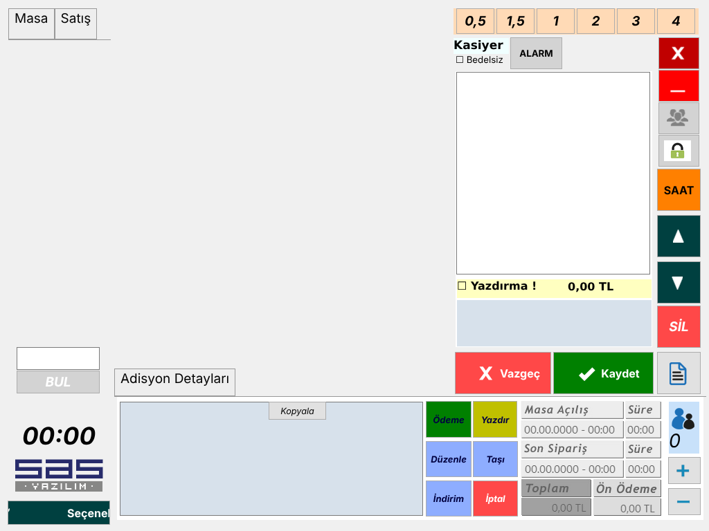
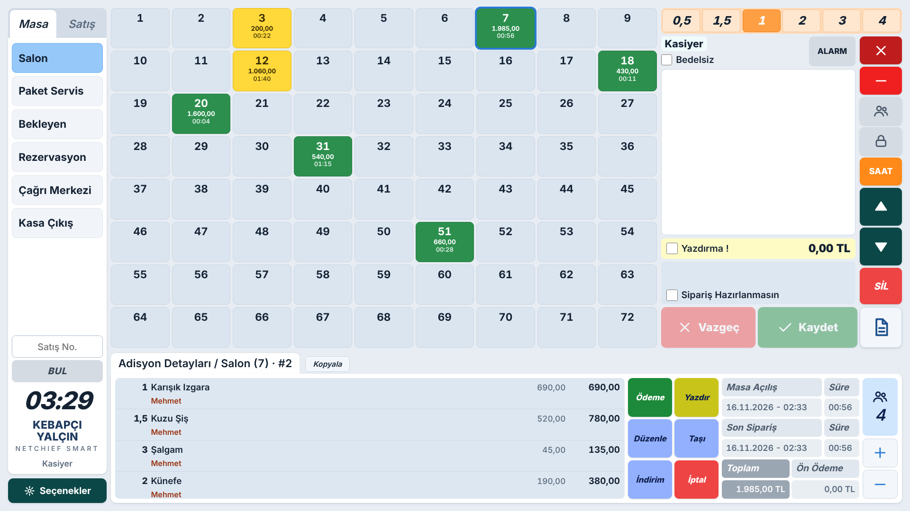

# NetCHIEF Smart — yeni kasa arayüzü (`pos/`)

Masaüstü **NetCHIEF Smart.exe** programının Node.js ile yeniden yazılmış sürümü. Ekran yerleşimi eski programla
aynıdır (sol: Masa / Satış sekmeleri, orta: 72 masa ya da ürünler, sağ: sipariş paneli, alt: Adisyon Detayları);
yalnızca görünüm yenilendi ve her ekran boyutuna ölçeklenir. Aynı `netchief` MySQL veritabanını kullanır, bu yüzden
eski program ve el terminalleriyle yan yana çalışabilir.

| Eski | Yeni |
|---|---|
|  |  |

```bash
npm install
npm run pos:demo      # örnek veriyle: http://localhost:3100  (Kasiyer / Yalçın: 1234 — Ahmet (garson): 1111)
npm run pos           # gerçek veritabanı (.env içinde POS_DB_* ya da POS_CONFIG_INI)
npm run pos:exe       # dist/NetCHIEF-Smart.exe üretir (tek dosya, kurulum gerektirmez)
npm test
```

**Exe kullanımı:** `NetCHIEF-Smart.exe` dosyasını eski programın klasörüne (`config.ini` yanına) koyun, yanına
`pos/pos.env.example` dosyasını `pos.env` adıyla kopyalayıp MySQL şifresini ve yazıcı adreslerini yazın. Exe sunucuyu
başlatır ve arayüzü Edge/Chrome uygulama penceresinde açar; diğer kasalar ve tabletler `http://<kasa-ip>:3100`
adresinden aynı ekranı kullanabilir. Arayüz dosyaları exe'nin içinde bellekten sunulur.

**Kapsam:** giriş (kullanıcı listesi + şifre), masalar, satış (0,5 / 1,5 / 1–4 adet, kg ürün, joker ürün, bedelsiz,
açıklama, teslim saati, "Yazdırma !", "Sipariş Hazırlanmasın"), Kaydet → yazıcıya göre mutfak fişi, Adisyon Detayları
(Ödeme: Nakit / Kredi Kartı / Multi Ödeme / Ödeme penceresi; Yazdır, Düzenle + sebepli iptal, Taşı / birleştir /
kısmi aktarım, İndirim, Kilit Aç, İptal, pax), Paket Servis müşteri seçimi, Rezervasyon, Çağrı Merkezi, Kasadan Çıkış,
BUL (satış no), Seçenekler (müşteriler / cari tahsilat / ekstre, kullanıcılar, bölümler, ürünler ve gruplar, raporlar,
gün sonu, tahsilat iptal). İş kuralları ve SQL'ler eski exe'nin kaynak çözümlemesinden alındı (`pos/lib/store.js`).

**Eski programa göre farklar / eklenenler:** masada tutar ve süre her zaman görünür; yetkisi olmayan kullanıcıda
iptal / indirim / bedelsiz için başka bir yetkilinin şifresi sorulur; kalem bazında not; rezervasyonda kişi / çocuk /
masa alanları artık kaydedilir; cari bakiye her işlemde satış − tahsilat olarak yeniden hesaplanır; SQL enjeksiyonuna
kapalı (parametreli sorgular); fiyat her zaman sunucuda ürün kaydından alınır.

**Henüz yok / dikkat:**
- Yazdırma yalnızca **ağ yazıcılarına** (ESC/POS, port 9100, `POS_PRINTERS`) yapılır; Windows yazıcı adına (USB) baskı,
  terazi, kart okuyucu, Caller-ID cihazı ve müşteri ekranı bağlanmadı. Yazıcı tanımlı değilse fiş ekranda önizlenir.
- Mobil API (SASncps, 8081), e-posta / SMS gönderimi, Senqron, Self Servis ve Hızlı Satış bölümleri taşınmadı;
  el terminalleri için eski program çalışmaya devam etmelidir.
- Canlı veritabanında **denenmedi**: testler demo şemasıyla SQLite ve MariaDB üzerinde geçiyor, ancak gerçek
  `netchief` şeması elimizde yok. İlk kurulumu veritabanının bir kopyasında deneyin.
- Windows exe'si bu ortamda üretildi ama Windows'ta çalıştırılıp denenemedi.
- Şifreler eski programla uyumluluk için veritabanında düz metin kalır.

Dosyalar: `pos/server.js` (API), `pos/lib/store.js` (iş kuralları), `pos/lib/db.js` (MySQL / SQLite), `pos/lib/print.js`
(fişler), `pos/lib/schema.js` (yalnızca demo / test şeması), `pos/public/` (arayüz), `pos/main.js` + `pos/build.js` (exe).

---

# SAS Smart PWA

SAS Smart Suite (restoran adisyon / POS) için **Node.js tabanlı, mobil öncelikli PWA**.

```
[ Telefon / PWA ] → HTTPS → [ Node.js (Express) proxy ] → HTTP → [ SAS sunucusu :8081 ]
```

## Özellikler

- Giriş (müşteri kodu / kullanıcı / şifre) → bölüm → masa → kategori → ürün → sepet → **sipariş kaydet**
- Açık adisyon detayı ve adisyon yazdırma
- **Bahçe / Salon ayrımı:** SAS'taki Salon masaları iki bölüme ayrılır (varsayılan: Bahçe = 1-15 ve 51, kalanı sıralı Salon)
- **Adisyon notu:** sepette masa geneli bir not (SaveSales `comm` parametresi)
- Masalarda Tümü / Dolu / Boş filtresi; menüde tüm kategorilerde ürün arama
- **Raporlar yalnızca kasiyere** görünür (yetki seviyesi 14'ün altı — orijinal uygulamadaki kural)
- **Ayarlar:** yazı büyüklüğü, kalınlığı ve yazı tipi (cihazda saklanır)
- **Yarım porsiyon:** SAS'ta ürün tipi 2 olan ürünlerde +½ düğmesi (0,5 / 1,5 porsiyon); kasiyer kategori bazında kapatabilir (adı "dürüm" içeren kategorilerde varsayılan kapalı)
- **Menü düzeni (kasiyer):** kasada kullanılmayan kategoriler ve ürünler (örn. "Kurye Bedeli") Ayarlar'dan gizlenir; listeler sunucuda `data/` klasöründe saklanır
- Raporlar: ödemeler ve satışlar (iş günü 06:00 başlangıcına göre)
- PWA: ana ekrana eklenebilir, uygulama kabuğu çevrimdışı açılır, açık/koyu tema
- `SasUsername` / `SasPasswd` header'ları yalnızca sunucuda tutulur; tarayıcıya gitmez
- Sipariş kaydında fiyat ve kullanıcı bilgisi istemciden değil sunucudan alınır

## Kurulum

Node.js 20.6+ gerekir.

```bash
npm install
cp .env.example .env      # SAS_HOST vb. değerleri düzenleyin
npm start                 # http://localhost:3000
```

Gerçek sunucu olmadan denemek için:

```bash
npm run demo              # kasiyer: demo / demo / demo — garson: demo / garson / garson
npm test                  # API testleri (demo verisiyle)
```

## Ayarlar (`.env`)

| Değişken | Açıklama | Varsayılan |
|---|---|---|
| `SAS_HOST` | SAS sunucusunun IP / alan adı | — (zorunlu) |
| `SAS_PORT` | SAS portu | `8081` |
| `SAS_USERNAME`, `SAS_PASSWD` | SAS servisinin beklediği header değerleri | — |
| `PORT` | Bu uygulamanın portu | `3000` |
| `TRUST_PROXY` | HTTPS reverse proxy arkasındaysa `1` | kapalı |
| `SESSION_HOURS` | Oturum süresi | `12` |
| `SAS_TIMEOUT_MS` | SAS istek zaman aşımı | `8000` |
| `SAS_TABLE_COUNT` | Her bölümdeki masa sayısı (SAS yalnızca açık masaları gönderir; boşlar buna göre çizilir) | `72` |
| `SAS_BAHCE_TABLES` | Bahçe sayılacak masa numaraları; boş bırakılırsa ayrım yapılmaz | `1-15,51` |
| `SAS_REPORT_MAX_AUTH` | Raporları görebilen en yüksek yetki seviyesi | `13` |
| `SAS_LOGIN_USERS` | Giriş ekranında seçilebilecek kullanıcı adları, virgülle (örn. `Yalçın,Ahmet`) | boş |
| `DATA_DIR` | Gizli kategori / ürün listelerinin saklandığı klasör | `./data` |
| `SAS_MOCK` | `1` ise demo verisi kullanılır | kapalı |

## Fiş yazdırma

SAS sunucusu, sipariş kaydedildiğinde (`SaveSales`) fişi kendiliğinden basar. Orijinal mobil
uygulamada (APK) bunu kapatan bir parametre yoktur; kasadaki "Yazdırma !" kutusunun mobil
API'de karşılığı bulunmaz. Yazdırmadan kayıt için SAS Yazılım'ın sunucuya bir parametre eklemesi gerekir.

## Sürüm

Arayüz dosyaları sürümlü adresle yüklenir: `/app.js?v=1.2.0-ab12cd3`. İlk kısım `package.json` içindeki
`version`, ikinci kısım dosyalar değişince kendiliğinden değişen kısa koddur. Telefonlar sunucudaki sürüm
farklıysa kendini yeniler; sürüm Ayarlar ekranında görünür.

## Yayına alma notları

- **Telefona kurulum ("Yükle") için HTTPS şarttır.** Yerel ağda bunun için sunucu, `PORT+1` üzerinde kendi
  ürettiği sertifikayla HTTPS de dinler (`HTTPS_PORT`; kapatmak için `0`). Her telefonda bir kez
  `http://<sunucu-ip>:<PORT>/kurulum` sayfasındaki adımlar izlenir: sertifikayı indir → Ayarlar'dan *CA sertifikası*
  olarak yükle → `https://<sunucu-ip>:<PORT+1>` adresini aç → *Yükle*. Sertifikalar `DATA_DIR/tls` altında saklanır;
  bu klasör silinirse telefonlara sertifikanın yeniden kurulması gerekir. İnternete açık kurulumda bunun yerine
  nginx / Caddy gibi bir reverse proxy kullanın ve `TRUST_PROXY=1` yapın.
- Node sunucusu SAS sunucusuna (`SAS_HOST:8081`) ağ üzerinden erişebilmelidir.
- Oturumlar bellekte tutulur; sunucu yeniden başlarsa kullanıcılar tekrar giriş yapar.
  Tek süreç (instance) olarak çalıştırın.

## API (tarayıcı → Node)

| Yol | SAS action |
|---|---|
| `POST /api/login` `{cc, username, password}` | `Auth!` |
| `GET /api/branches` | `Branch!?Auth=22` |
| `GET /api/fields` | `Fields!` |
| `GET /api/tables?field=&part=` | `TableStatus!` |
| `GET /api/categories` | `MenuCat!` |
| `GET /api/products?cat=` | `Product!` |
| `POST /api/orders` `{fid, tid, sid, comm?, items:[{id, quantity, comment}]}` | `SaveSales!` |
| `GET /api/sales/:sid` | `SalesDetails!` |
| `POST /api/sales/:sid/print` | `SalesPrint!` |
| `GET /api/reports/{payments,sales}?start=YYYY-MM-DD&end=YYYY-MM-DD` | `Payments!` / `SalesReport!` |

## Dosya yapısı

```
server.js         Express: oturum, doğrulama, /api rotaları, statik dosyalar
lib/sas.js        SAS istemcisi + yanıt zarfı / DTO dönüştürücüleri
lib/mock.js       Demo modu için sahte SAS sunucusu
public/           PWA (index.html, app.js, styles.css, sw.js, manifest, ikonlar)
test/             node:test ile API testleri
```
